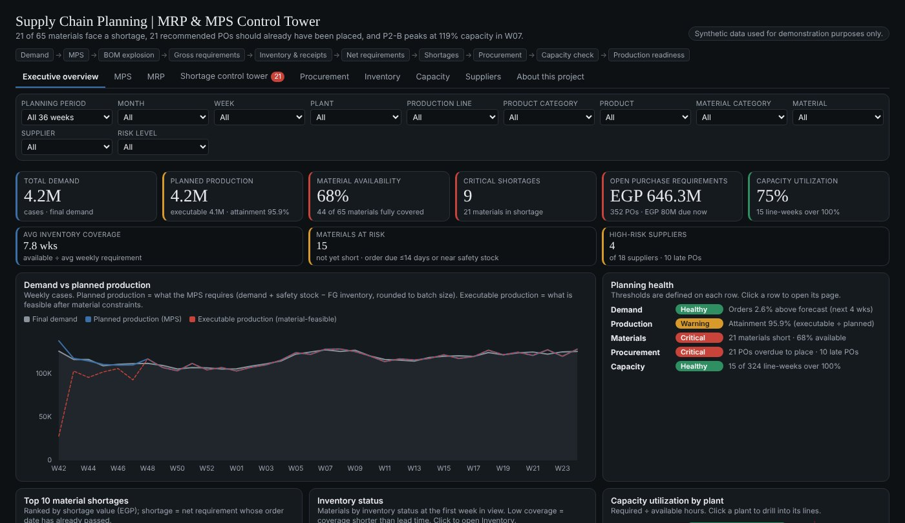
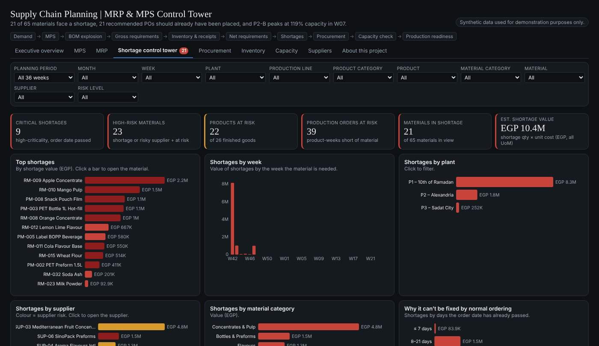
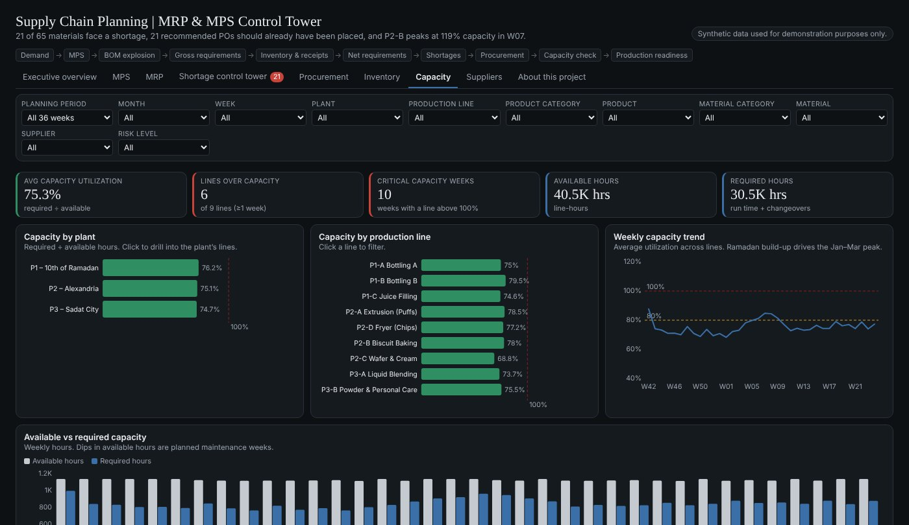

# Supply Chain Planning | MRP & MPS Control Tower

**End-to-End Supply Chain Planning Analytics**

An interactive control tower that connects demand, Master Production Scheduling (MPS), BOM explosion, Material Requirements Planning (MRP), inventory, procurement, supplier risk and production capacity, to identify material shortages and improve production readiness.

**[View the interactive dashboard](https://youssefsaeed-portfolio.vercel.app/demos/supply-chain/)**

> **Synthetic data used for demonstration purposes only.** This is a portfolio project about a fictional manufacturer ("Delta Consumer Products"). It uses no data from any real company and was not built for a real employer or production environment.

| Executive overview | Shortage control tower | Capacity planning |
|---|---|---|
|  |  |  |

## Business problem

Manufacturers must keep demand, production plans, material availability, supplier lead times, inventory levels and line capacity aligned. Without one integrated planning view, shortages and capacity constraints are detected too late to fix with normal ordering.

## Planning flow

Demand → MPS → BOM explosion → gross material requirements → inventory and scheduled receipts → net material requirements → material shortages → procurement → capacity check → production readiness

## Business logic

- **Final demand** = MAX(forecast, customer orders).
- **Planned production (MPS)** = (demand + safety stock − opening FG inventory), rounded up to the batch size.
- **Gross requirement** = planned production × BOM quantity × (1 + scrap).
- **Net requirement** = MAX(gross + safety stock − available inventory − scheduled receipts, 0), time-phased week by week.
- **Order date** = required delivery date − supplier lead time. A **shortage** is a net requirement whose order date has already passed, so a standard-lead-time PO cannot arrive in time.
- **Procurement recommendations** are sized to MOQ multiples and a 4–8 week cover target (by lead time).
- **Planned vs executable production are kept separate.** Executable production is planned production reduced where material shortages block it. Plan attainment = executable ÷ planned. MPS status is evaluated on the executable plan.
- **Capacity hours** = quantity ÷ run rate + batches × changeover time. Utilization = required ÷ available hours, evaluated by plant, line and week.
- Status sets: Material (Healthy / At Risk / Shortage), MPS (Healthy / Risk / Shortage), Capacity (Healthy / High Utilization / Capacity Risk / Over Capacity), Supplier risk (Low / Medium / High / Critical).

## Dashboard pages

Executive Overview · MPS · MRP · Shortage Control Tower · Procurement Planning · Inventory Analysis · Capacity Planning · Supplier Performance & Risk · About This Project

Global filters (period, month, week, plant, line, product category, product, material category, material, supplier, risk level), cross-filtering and drill-downs (material → supplier → open POs → BOM usage).

## Decisions supported

Production readiness, material shortage prioritization, procurement timing, inventory planning, supplier risk management and capacity planning.

## Data model (synthetic)

26 finished goods · 65 raw and packaging materials · 249 BOM lines · 3 plants · 9 production lines · 18 suppliers · 36 weekly planning buckets (planning date 14 Oct 2026). Every table is derived from the one before it, so totals reconcile across pages.

## Repository layout

| Path | Contents |
|---|---|
| `data_model/` | Python model that generates and reconciles all tables (`master.py` → `products.py` → `plan1.py` → `plan2.py` → `plan3.py`); `export.py` writes the JSON tables |
| `data/` | The exported tables (JSON), exactly as loaded by the dashboard |
| `dashboard/` | Dashboard source: HTML, CSS and JavaScript (D3.js v7) |
| `preview/` | Small local harness to open the dashboard in a browser |
| `tests/` | Headless smoke test across all pages and filter combinations |

## Run it

Regenerate the data (Python 3.10+, numpy):

```bash
pip install numpy
python data_model/export.py
```

Preview the dashboard locally (loads D3 from a CDN):

```bash
python -m http.server 8000
# open http://localhost:8000/preview/
```

Run the smoke test (Node 18+):

```bash
cd tests && npm install && npm test
```

## Tools

Claude Dashboard (the interactive page), D3.js, Python (numpy) for the data model.

The dashboard code targets the Claude Dashboard runtime, which supplies the `dash` data API. `preview/index.html` provides a minimal stand-in so the page can also run locally.

## Limitations

- Synthetic and deterministic (seeded) data; thresholds are illustrative, not calibrated on real operations.
- Executable production applies a simple material-availability factor; it is not a constrained optimisation, and capacity does not feed back into it.
- Quantities in different units of measure are never summed; aggregate KPIs use counts or EGP value.
